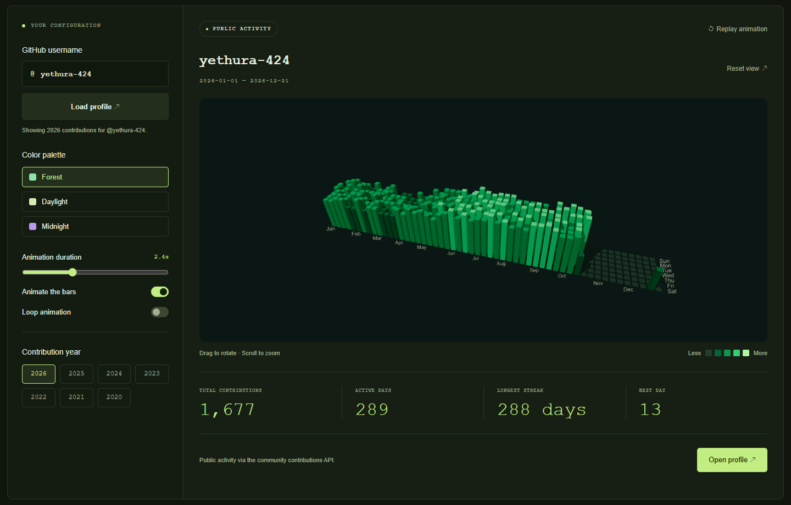
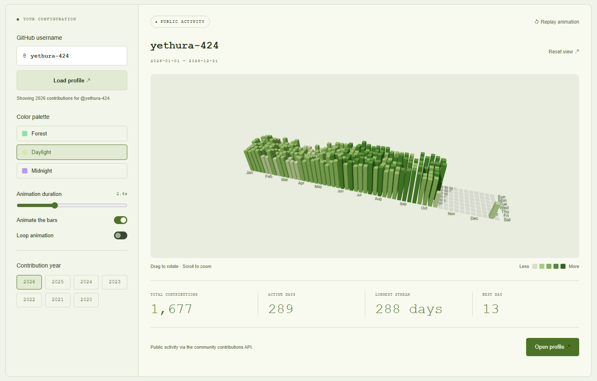
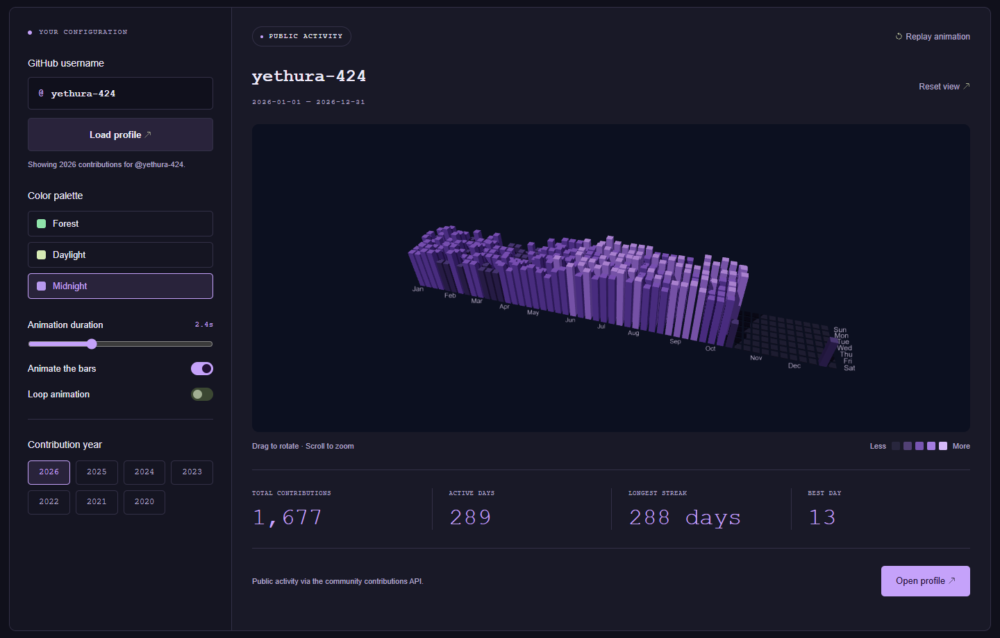
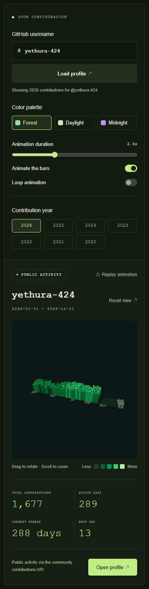

# Contribution Bar

Explore GitHub contribution history as animated 3D bars. Built for fellow developers and GitHub enthusiasts curious about coding activity, Contribution Bar turns a familiar contribution calendar into a landscape you can rotate, zoom, and explore.

<table>
  <tr>
    <td width="50%"> <strong>Daylight</strong>. A lighter view of your activity.</td>
    <td width="50%"> <strong>Midnight</strong>. Purple bars on a dark canvas.</td>
  </tr>
</table>

  
See the mobile preview

   
  

Each preview is captured from the running app. Click a thumbnail to see it at full size.

Whether you're looking back at a productive year, exploring a fellow developer's public activity, or simply enjoying an animated contribution graph, this project gives you a different perspective on the history behind those little squares.

You can:

- **Explore a GitHub profile:** enter a username and load its contribution history without signing in.
- **Travel through the years:** switch between the contribution years returned for that profile.
- **Watch activity grow:** replay the bar animation, adjust its duration, or enable looping.
- **Inspect the graph:** drag to rotate, scroll to zoom, hover over a bar for its date and contribution count, and reset the camera whenever you like.
- **Choose your palette:** switch between Forest, Daylight, and Midnight.
- **See the highlights:** review total contributions, active days, longest streak, and the best day for the selected year.
- **Use it across screen sizes:** the layout adapts to desktop and mobile, and respects your device's reduced motion preference.

Bar height and color intensity represent daily contribution counts. Profile history comes from the community [GitHub Contributions API](https://github.com/grubersjoe/github-contributions-api). When a profile cannot be loaded, the app retains its existing graph; the initial sample graph is clearly labeled as sample activity.

Built with **Three.js**, **Tailwind CSS**, and **JavaScript modules**. The app runs in the browser and can be hosted as a static website.

For installation, local development, styling, and the JavaScript module structure, see **[SETUP.md](SETUP.md)**.
